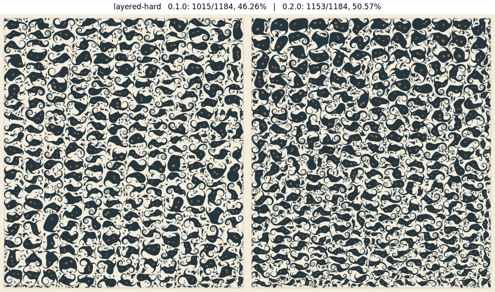

# Budel Craft



> **One of 18 related repositories.** The [repository overview](https://github.com/dietmarwo/fcmaes-rust/blob/main/docs/repositories.md) shows what each one does and how they connect.

Budel Craft packs the supplied irregular figures into a rectangular sheet. It uses native Rust geometry, retains the original polygons, and exports the assignment's placement JSON. For optional stock it maximizes placed scoring area. For mandatory stock it seeks a complete feasible layout.

```bash
cargo build --release --locked
target/release/budel solve cases/small.json --budget interactive \
  --output out/small.answer.json --run-dir out/small-run
target/release/budel validate cases/small.json out/small.answer.json
```

The default build needs Rust 1.88 or later and standard Cargo dependencies. Build with `--features fcmaes` to enable the policy tuner (DE, BiteOpt, random) and the experimental DE neighborhood operator. The solver has its own polygon kernel. NumPy and Pillow are used by the separate Python judge.

Version 0.2.0 replaces the multi-start search with persistent search on the incumbent, adds slide-to-contact compaction, raster pocket insertion, overlap-tolerant insertion with guided local search, optional late acceptance, shared incumbents between workers and a non-blocking certification mailbox. See [the 0.2.0 results](docs/PERFORMANCE.md) and [the implementation log](IMPLEMENTATION_LOG.md).

- [User manual and examples](docs/USER_MANUAL.md)
- [Architecture](docs/ARCHITECTURE.md)
- [Requirements and judge audit](docs/REQUIREMENTS.md)
- [Measured results](docs/PERFORMANCE.md)
- [Implementation log](IMPLEMENTATION_LOG.md)
- [Original implementation plan](docs/IMPLEMENTATION_PLAN.md)

The six original inputs and the later `extreme` case (3,309 figures) are in `cases/` with their SHA-256 manifest. The measured layouts, validation reports and SVG examples are included under `evidence/` (0.1.0 records at the top level, 0.2.0 records in `evidence/v0.2.0/`) and `examples/`. The source uses a custom construction and search loop. PackingSolver is an optional external comparison.

Budel Craft is released under the [MIT License](LICENSE).
