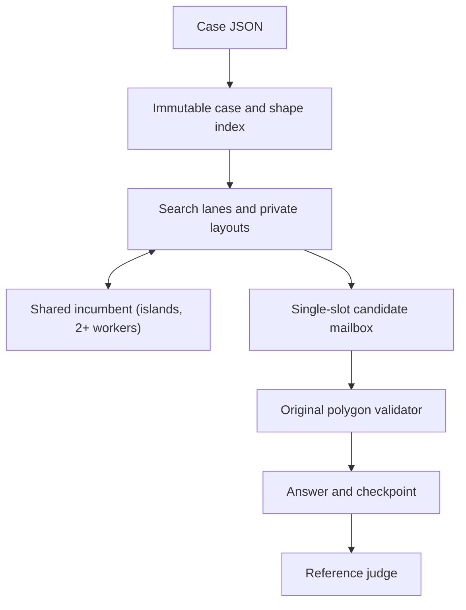

# Budel Craft architecture

Budel Craft separates source geometry, mutable search state, and certified answers. Each search worker improves its own layout. The coordinator validates the newest best snapshot with a separate traversal over the original body rings before publishing it.

## Code map

| Path | Role |
| --- | --- |
| `src/model.rs` | Typed input and output, score area, numeric limits, item identities, SHA-256 |
| `src/geometry/mod.rs` | Rigid transforms, AABBs, predicates, reference pair queries |
| `src/geometry/index.rs` | Convex hulls for bounds, edge hierarchy, inscribed discs, lazy interior poles, penetration proxy, pose cache |
| `src/layout.rs` | Placed items, spatial grid, candidate blockers, insertion/removal |
| `src/search/mod.rs` | Policy, feature switches, restart and persistent phases, late acceptance, shared incumbent |
| `src/search/construct.rs` | Free rectangles, priority orders, geometric insertion proposals, first-fit or best-of-k placement |
| `src/search/improve.rs` | Slide-to-contact compaction, rotation compaction, area exchanges, rebuild transactions, isolated repair |
| `src/search/pockets.rs` | Raster occupancy and exact distance transform; pocket-targeted insertion |
| `src/search/separate.rs` | Overlap-tolerant insertion with penetration proxy and guided-local-search weights |
| `src/search/fcmaes.rs` | Optional DE/BiteOpt/random policy tuning over several seeds, and DE block evaluation |
| `src/runtime.rs`, `src/execution.rs` | Budgets, interruption, portfolio, certification and checkpoints |
| `src/validate.rs`, `src/export.rs` | Strict reports, atomic JSON, original-artwork SVG |
| `tools/` | Reference judge, campaign supervisor, PackingSolver adapter, job staging |

## Geometry

The parser checks simple finite rings, valid dimensions and unique IDs. It preserves artwork and supports either input winding. A collision geometry is shared by exact coordinate matches, which reduces the 1,008 `uniform-hard` IDs to 508 indexed bodies. ID, artwork, and scoring metadata remain attached to each item.

The orientation predicate starts with a floating-point filter. A near-zero determinant falls back to exact integer arithmetic on the dyadic representations of the supplied binary64 coordinates. Pose transforms and point-to-edge distances still use binary64. Spacing decisions include a numerical guard. Search uses an extra guard when shifting from one item's local coordinates into the other's frame.

The grid indexes transformed bounds. A query expands the requested bounds by the clearance and deduplicates candidates with generation stamps. Oversized queries fall back to the current placement list. The next stages use enclosing AABBs, optional inscribed discs for early rejection, and a tree over original edges. Tree leaves test segment intersections and squared distances. A separate point-in-polygon test catches containment. The accelerated containment query prunes the edge tree along its ray.

A cached orientation is keyed by geometry, exact normalized angle and mirror bit. It includes rotated vertices and tree bounds. FIFO eviction bounds the cache bytes per worker. A live placement can retain an evicted orientation through its shared reference. The process supervisor measures this storage as part of total memory.

The strict validator rebuilds world-coordinate rings from serialized poses. It checks every potentially close pair using a scalar edge scan with bounding-box rejection. The independent Python judge supplies a second implementation. `certified_gap` reports the threshold checked for every pair. A global minimum distance would require a different query.

## Search

A lane has two phases. It first runs `policy.restarts` construction attempts (default 5). Each attempt packs compact bounding rectangles into free rectangles, slides the result toward the lower-left, fills gaps with contour-level proposals and runs one short improvement burst. Order keys, angles and reflections vary between attempts. Shapes with eight allowed angles keep exact discrete poses.

The persistent phase then works on one layout, starting from the lane's best. It repeats the following round until the stock is placed or the budget ends:

1. **Slide compaction.** Every placed item slides toward the lower-left corner by step halving on the strict `fits` predicate, in `slide_sweeps` sweeps. Area is unchanged and every intermediate pose is feasible. Free space merges toward the opposite corner.
2. **Pocket insertion** (after `rescue_after` rounds without a new best). The layout is rasterized at about 160,000 cells; an exact Euclidean distance transform gives each free cell a conservative clearance. A missing item is tried where the clearance exceeds its largest interior pole radius plus the gap: half the trials at the tightest qualifying cells, half at random ones.
3. **Gap filling** with sampled contour proposals, first-fit or best-of-k (`best_of`, each feasible proposal slid to contact and scored by its lower-left extent).
4. **Rotation compaction and neighbourhood rebuilding.** An omitted figure is proposed, its blockers are removed (at most `rebuild_size`, cost weighted by `blocker_weight`), and the blockers are reinserted around it. Optional stock accepts area gains, or under late acceptance (`late_length` > 0) moves within the area recorded `late_length` moves earlier. Mandatory stock prefers count, then area. Rejected rebuilds restore placements, grid and area exactly.
5. **Overlap-tolerant insertion** (after `rescue_after` stalled rounds). A missing item, chosen by a tournament on area discounted by its earlier failures, is seated where it overlaps least. Colliding items then move to the pose with the lowest weighted overlap, found by sampling and coordinate descent. The overlap of a conflicting pair is the summed penetration of interior pole discs plus a base term, multiplied by a guided-local-search weight that grows while the pair keeps colliding. The attempt ends feasible, or restores every moved item exactly after `separate_moves` moves or six sweeps without a 1% drop in raw overlap. No snapshot is published while overlaps exist.
6. **Islands.** With several workers, each lane offers its best to a shared incumbent and adopts a better one at the end of a round.

After six rounds without a new best, a lane whose working layout fell below its best restarts from the best. Interior poles are computed on first use by a greedy pole-of-inaccessibility cover on a 22×22 sample grid (at most 12 discs, each inset by four guards), so cases that never call the pocket or separation operators do not pay for them.

All feasibility decisions use the same conflict predicate as before; the raster and the pole discs only propose positions and rank overlapping states. `multistart` keeps the 0.1.0 behaviour (up to 512 independent attempts with short bursts) as a comparison arm. Each persistent component has a CLI switch (`--no-slide`, `--no-pockets`, `--strict-accept`, `--no-separate`, `--no-share`) and a policy field; the measured campaign decides the defaults.

The repair arms score only small temporary blocks. A confirmed conflict contributes a bounding-box penetration proxy, while bounds violations add an outside cost. A zero-cost block must pass exact geometry and final certification. Free-angle DE uses at most 24 continuous coordinates, and its ask/tell loop counts actual completed evaluations.

Policy tuning varies ten search-control fields with fixed work per trial and averages several training seeds per candidate. The default policy is the first candidate of every method; the selected and default policies are then compared on separate held-out seeds.

## Scheduling and recovery

A shared monotonic deadline leaves time for certification. A shared atomic proposal counter prevents work-limit overshoot across workers. Workers own their mutable layout and RNG and share immutable geometry. They offer improved snapshots to a single-slot mailbox that keeps only the best unrecorded one, so a worker never waits for validation; the coordinator validates the newest best and owns file publication. The metrics report how many offered candidates were superseded before validation. The final record reuses the report of the last accepted snapshot instead of validating it again. Single-worker runs with a work limit offer the most reproducible search order.

Answer and checkpoint writes flush a temporary file and rename it in the same directory. Interrupted writes preserve the previous completed file. Resume assumes the filesystem retained the last renamed checkpoint. The snapshot includes the case and configuration hashes, poses, elapsed time, proposals and attempt count. Resume rebuilds from that snapshot, checks it, and starts a new seeded search lane. The RNG stream and the in-flight neighborhood are restartable work rather than serialized state.

The Python supervisor uses a separate process group, an address-space ceiling, sampled process-group RSS, bounded logs and a wall watchdog. Scheduling and filesystem delays appear in observed wall time. The solver's internal timing and the supervisor's elapsed timing have distinct fields. For campaigns, the Python reference check has its own timeout.

The job adapter stages the solver and input as hashed files under the existing `execution.command/0.1` contract. The upstream runner owns its command result and cancellation protocol. Budel's packing metrics are a domain artifact. The implementation keeps optimization in the Rust process.
